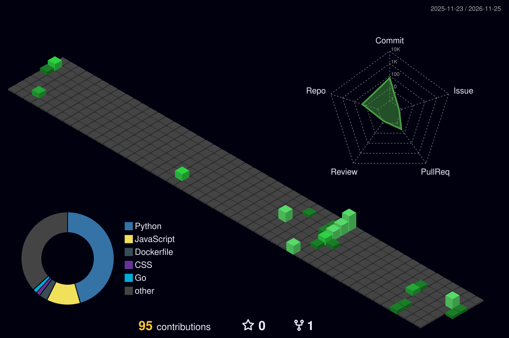

# Rishi Kumar

### Product Engineer who likes building reliable telecom and backend systems

Hey, I'm Rishi. For the past 4.5+ years, I've worked on telecom charging systems, backend services, and Python tools that make engineering work a little easier. Most days, that means working with C, Python, Diameter, and Cassandra.

 &nbsp;  &nbsp; 

## A bit about my work

- I'm a Product Engineer on TCS's 4G-CDOT team, working on telecom charging and Diameter accounting. Before that, I was a Systems Engineer on the 5G Core team.
- I work with C, Cassandra, and Python tools for traffic generation, testing, and automation. I've also built a FastAPI CSV-to-database service and used Plotly to explore performance data.
- I enjoy making repetitive engineering tasks easier, from deployment helpers to log filters and monitoring dashboards.

## Things I use

  

Also in the mix: Cassandra, Diameter, Pandas, NumPy, Matplotlib, Plotly, Wireshark, and GitHub Copilot.

## A few other things

- Made a Clang-based script to add logging snippets to a C++ codebase.
- Solved 1,000+ problems on LeetCode and 300+ on CodeChef.
- Microsoft Certified GitHub Copilot credential; also a zonal topper and gold medalist in the International Mathematics Olympiad.

I studied Information Technology at the Institute of Engineering and Management (B.Tech, GPA 9.0/10).

## Around here on GitHub

  
   
  <!--  -->

